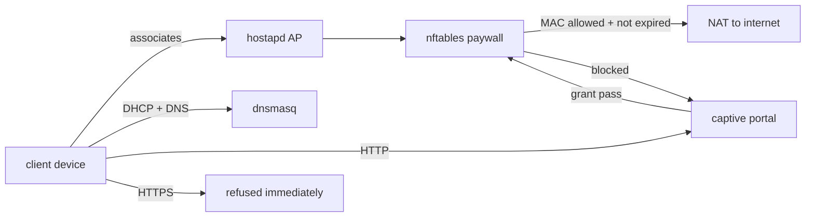

# Architecture

piso-hotspot is one binary: a CLI that drives a root daemon, a captive
portal, an admin panel, and in-kernel access enforcement via nftables.

## Components

| Module | Responsibility |
| --- | --- |
| `main.rs` / `control.rs` | CLI commands; the control socket between CLI and daemon (root-only) |
| `daemon.rs` | Lifecycle: bring up AP, DHCP, NAT, paywall; teardown on stop/crash |
| `radio.rs` / `wireless.rs` / `viface.rs` / `iwlist.rs` | Radio probing, AP mode selection, virtual interfaces, uplink choice |
| `nft.rs` / `paywall.rs` / `ufw.rs` / `shaper.rs` | nftables rules, per-MAC allow-list, UFW integration, bandwidth caps |
| `passes.rs` / `store.rs` | Pass menu, pricing, expiry; SQLite state (`/etc/piso-hotspot/state.db`) |
| `http.rs` / `auth.rs` | Admin panel HTTP + session auth |
| `portal.rs` | Captive portal page served to unpaid clients |
| `config.rs` | Strict JSON config with defaults (see docs/CONFIG.md) |
| `doctor.rs` | Read-only machine inspection |

## Packet path

Enforcement is in-kernel, per MAC: joining the Wi-Fi alone grants
nothing, and one paid device cannot relay a friend's traffic through
its own address.

## Why the paywall comes up before forwarding

`start` installs the nftables ruleset *before* NAT/forwarding is
enabled, so no client ever sees ungated internet, even during the first
seconds of bring-up.

## State and config

- Config: `/etc/piso-hotspot/config.json` (optional; defaults apply).
  Never written by the program.
- State: `/etc/piso-hotspot/state.db`, written by the daemon. The
  binary migrates its schema on open.
- Runtime: `/run/piso-hotspot/` (control socket, daemon log).

## Security posture

The daemon runs as root and edits the firewall; the panel is plain HTTP
on the LAN and treats its passphrase as a local credential. See
SECURITY.md for reporting and scope.